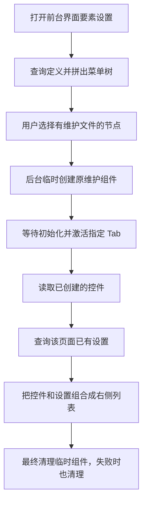
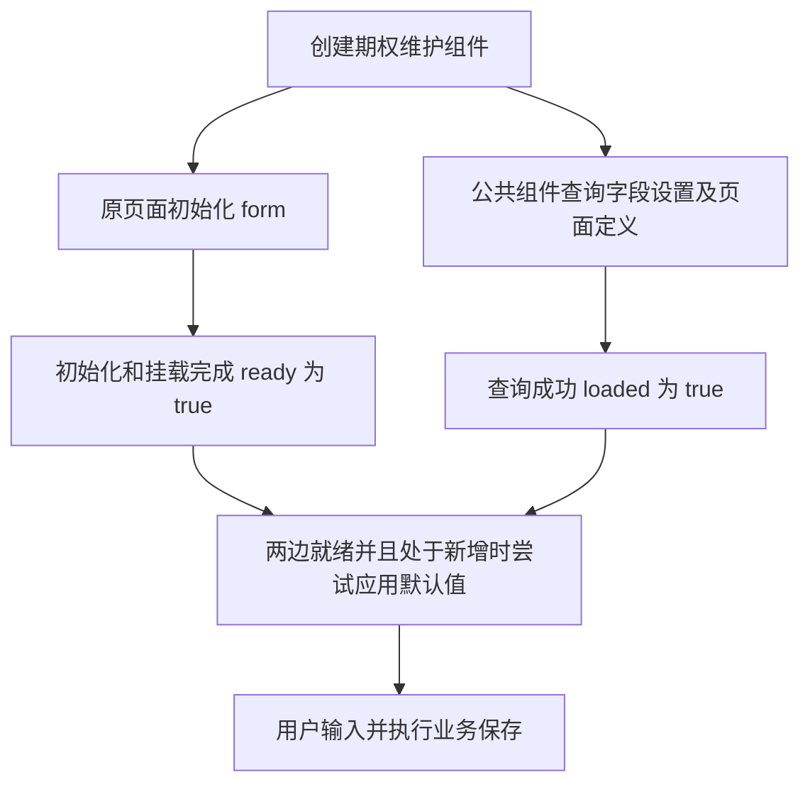

# 维护界面字段配置：代码讲解（新手版）

适用代码：本项目当前的“前台界面要素设置”公共模块，包含 2026-11-09 的内部优化。

这份文档解释“代码为什么这样写、各文件怎样配合”。如果你要给一个新维护窗口接入功能，请同时看 [维护界面字段配置接入指南](maintenance-field-config-guide.md)，里面有完整的接入代码。

## 1. 先知道这套代码解决什么问题

以“期权属性”为例，维护窗口里有合约代码、行权价格、标的证券等控件。以前，是否必填、初始值是什么，由开发者写在页面代码里。现在，用户可以到“前台界面要素设置”菜单中修改这些设置，再打开业务维护窗口时生效。

你可以先记住这条流程：

```text
用户设置字段 → 后端保存设置 → 维护窗口读取设置 → 修改校验规则和新增初始值
```

这里有两种不同的“保存”：

| 用户操作 | 保存的是什么 | 负责的代码 |
| --- | --- | --- |
| 在“前台界面要素设置”中点保存 | 哪个字段必填、默认填什么 | 这套公共模块 |
| 在“期权属性”维护窗口中点保存 | 合约代码、价格等真实业务数据 | 原期权页面的业务保存代码 |

例如，把行权价格的默认值设成 `12.50`，只是规定“以后新增时先填这个数”，不是修改数据库中已经存在的期权价格。

## 2. 看代码前，先认识这些词

遇到不认识的词，可以回来查这张表，不需要一开始背下来。

| 词 | 用普通话解释 | 本项目的例子 |
| --- | --- | --- |
| 控件 | 界面上的输入工具 | 文本框、日期选择框、证券选择框 |
| 字段 | 一个具体的数据项目 | `exercisePrice`，表示行权价格 |
| 表单 | 把一组输入项目放在一起，方便检查和提交 | 原页面的 `el-form` |
| model／模型 | 在内存里装着用户输入值的对象 | `form.exercisePrice` |
| label | 用户看见的中文名称 | `行权价格` |
| prop | 表单内部识别字段的名字 | `exercisePrice` |
| rules／规则 | 判断输入是否合法的条件 | 是否必填、数值范围、日期关系 |
| 组件 | 可以被其他页面使用的一块界面或能力 | `maintenance-config.vue` |
| mixin | 向多个维护页面加入一组共同方法 | `createMaintenanceConfigMixin` |
| 接口 | 前端向后端取数据或保存数据的入口 | `queryUielementconfig` |
| 挂载 | 页面组件已经被创建并参与界面渲染 | 打开维护窗口，或后台临时创建窗口 |
| 销毁／卸载 | 组件关闭后，清理它登记的内容和任务 | 临时读取完控件后销毁窗口 |
| 异步 | 一件事情需要等待，例如请求后端 | 等查询配置返回 |
| 索引 | 提前建好查找关系，之后按名字直接找 | 用字段名查对应配置 |

再认识几个常见写法：

- `async` 和 `await`：表示这里有事情需要等待；例如 `await 查询配置()` 是等配置回来，再继续后面的代码。
- `Promise`：表示“结果会在稍后返回的一项任务”，异步查询通常返回这种对象，`await` 可以等待它完成。
- `ref(...)`、`.value`：公共组件中保存可变化状态的方式；例如 `loaded.value` 表示“配置是否已读取成功”。模板中的 `ref="maintenanceConfig"` 则是给组件引用起名，二者用途不同。
- `computed(...)`：根据已有数据计算结果；相关数据没变化时，可复用上次结果。
- `watch(...)`：当指定的数据变化时，执行一段处理。
- `nextTick(...)`：等本轮界面更新完成，再读取新创建出来的表单和控件。
- `Map`：保存“名字 → 对应内容”；`Set`：保存不重复的项目。名称中带 `Weak` 的容器用于记录对象，避免仅因这个容器而一直留住已不用的对象。

## 3. 两张表各管什么，字段怎样对上

### 3.1 要素定义表：告诉程序去哪里找界面

定义表负责登记菜单和维护文件，不负责保存每个字段的必填设置。

| 字段 | 意义 |
| --- | --- |
| `menu_id` | 业务菜单的编号 |
| `menu_parent_id` | 上级菜单的编号，用来拼出左侧树 |
| `menu_name` | 菜单中文名称 |
| `menu_position` | 同级菜单展示顺序 |
| `page_id` | 菜单下的维护页面／Tab 编号 |
| `page_name` | 页面名称；有 Tab 时，必须等于它的标题 |
| `file_path` | 实际维护组件的文件路径；为空时只作为树的层级节点 |

期权的维护组件是：

```text
src/views/securityManager/optionView/dialog/oper-option-dialog.vue
```

定义中的路径可以使用：

```text
securityManager/optionView/dialog/oper-option-dialog.vue
```

程序通过路径找到当前前端构建里已存在的组件，然后创建组件来读取控件。**它不会去修改这个 Vue 文件，也不是读取文件文本后搜索“文本框”三个字。**

### 3.2 要素设置表：告诉程序某个字段怎么处理

设置记录的核心是下面五项：

| 字段 | 意义 | 示例 |
| --- | --- | --- |
| `menu_id` | 哪个菜单 | `203010`，期权属性 |
| `page_id` | 哪个维护页面／Tab | `1`，这里只是讲解用的示例编号 |
| `field_name` | 哪个字段，对应原表单 prop | `exercisePrice` |
| `is_required` | 是否必填 | `1` 是必填，`0` 是非必填 |
| `param_default_value` | 文本形式的默认值 | `12.50` |

实际 `page_id` 以定义接口返回为准，不要因为文档举例用了 `1`，就在所有页面中写死 `1`。

**一条设置由“菜单 + 页面 + 字段”一起确定。** 两个 Tab 即使都有 `exercisePrice`，也可以分别配置。

中文名称来自原控件的 `label`，不作为设置主键。所以“行权价格”改成“期权行权价格”时，只要 `prop` 仍是 `exercisePrice`，对应关系仍在。

### 3.3 为什么代码里还有 formKey

`formKey` 是前端给维护文件起的稳定标识：把 `src/views/` 后面的路径去掉 `.vue`，再把 `/` 换成 `.`。

```text
文件：securityManager/optionView/dialog/oper-option-dialog.vue
标识：securityManager.optionView.dialog.oper-option-dialog
```

前端内部有时会把标识加到字段名前面：

```text
securityManager.optionView.dialog.oper-option-dialog.exercisePrice
```

它用于区分维护文件。调用当前正式配置接口时，`fieldName` 仍然只传 `exercisePrice`，公共服务会处理这个内部前缀。

数据库和接口的命名也有区别：XML／表字段常写 `menu_id`，当前接口请求写 `menuId`。请求统一采用项目已有的列表格式，例如：

```json
{
  "p1List": [
    { "menuId": "203010", "pageId": "1" }
  ]
}
```

`p1List` 就是装请求记录的数组；能装一条，也能装多条。公共模块会完成名称转换，页面不需要自己拼这些请求。

## 4. 文件很多，应该先看哪个

先看使用它的页面，再顺着调用看公共模块，比从头读所有工具函数容易。

以下路径均以项目 `fm-basic-web` 为起点：

| 文件 | 负责什么 | 可以先关注的方法 |
| --- | --- | --- |
| `src/views/securityManager/optionView/dialog/oper-option-dialog.vue` | 原期权维护表单及初始化 | 模板最外层、mixin、`resetForm` |
| `src/bizcommon/maintenanceConfig/page-mixin.ts` | 给业务页面加入公共入口，跟踪初始化 | `maintenanceRules`、`maintenanceValidate` |
| `src/bizcommon/tradeComponents/bizCommon/maintenance-config.vue` | 协调查询、字段登记、规则、默认值和设置编辑 | `reloadSettings`、`recordFor`、`applyDefaults` |
| `src/bizcommon/maintenanceConfig/form.ts` | 读写字段值，合并校验，转换默认值 | `createNativeFormRegistry`、`mergeFieldRules`、`parseDefaultValue` |
| `src/bizcommon/maintenanceConfig/runtime-fields.ts` | 从运行中的组件读取控件信息和 Tab 归属 | `discoverRuntimeFields` |
| `src/bizcommon/maintenanceConfig/service.ts` | 查询设置、计算保存差异、调用修改接口 | `loadMaintenanceConfig`、`createUiElementConfigTransport` |
| `src/bizcommon/maintenanceConfig/definitions.ts` | 查询定义、整理文件路径和页面编号 | `loadUiElementDefinitions`、`resolveUiElementPages` |
| `src/bizcommon/maintenanceConfig/types.ts` | 约定数据应有哪些属性和类型 | `FieldDescriptor`、`MaintenanceConfigRecord` |
| `src/views/userManage/uiElementConfig/index.vue` | 独立配置菜单入口 | `loadDefinitions`、`selectDefinition` |
| `src/views/userManage/uiElementConfig/tree.ts` | 把菜单列表组装成树 | `buildDefinitionTree` |
| `src/bizcommon/tradeComponents/bizCommon/maintenance-field-editor.vue` | 显示设置表格、勾选框和按钮，向外报告操作 | 模板中的 `rows` 和事件 |
| `src/bizcommon/tradeConfig/urlconfig.ts` | 三个正式接口的地址 | `query_uielementdefine` 等常量 |

可以先把 `maintenance-config.vue` 理解为协调者，`form.ts` 和 `runtime-fields.ts` 是具体干活的工具，`service.ts` 是与后端沟通的入口。

`types.ts` 里的 `interface` 只描述数据格式，不会查询接口。例如 `defaultValue: string | null` 表示“默认值要么是一段文本，要么没有设置”。

## 5. 用户进入配置菜单时，代码做了什么



### 5.1 先构建树，再处理选中的页面

配置页的 `mounted` 调用 `loadDefinitions`。它通过 `definitions.ts` 查询定义，再交给 `tree.ts` 根据 `menu_id` 和 `menu_parent_id` 组装树。

`file_path` 为空的节点只用于层级展示。有路径的节点才能继续读维护控件。同一菜单有多个页面定义时，树下会分别展示这些页面。

用户选择节点后，`selectDefinition` 根据文件路径找到组件，生成对应 `formKey`，并把它交给右侧公共组件的 `openSettings`。

### 5.2 为什么要后台创建一个维护窗口

维护窗口不打开时，很多控件根本还没被创建。想知道它们的名称、类型及绑定值，就临时创建一次原组件，读取后销毁。

这里的“后台”是指浏览器中的隐藏组件，不是启动一个后端程序，也不会向用户弹出业务维护窗口。

临时组件仍可能执行原来的初始化、字典查询等代码。因此原维护组件的初始化不能自动提交业务数据。公共模块通过 `discoveryMode` 标识这次只是采集，避免临时窗口再次读取自己的字段设置或应用配置默认值。

### 5.3 控件列表到底怎么读出来

`runtime-fields.ts` 读取组件已经渲染出的节点。代码里的 `VNode` 可以理解为“框架在内存里保存的界面结构说明”。

对一个表单项，程序主要读取：

| 读取内容 | 用途 |
| --- | --- |
| `label` | 右侧列表显示中文名称 |
| `prop` | 和配置中的字段名对应 |
| 外层控件类型 | 判断普通文本、数字、日期还是业务控件 |
| `modelValue` 和更新方法 | 知道从哪里读值、往哪里赋值 |
| 精度、日期格式、多选属性 | 判断默认值能否转换 |
| 所在 Tab 的标题 | 确定设置属于哪个 page_id |

例如，证券选择控件内部也可能有文本框。程序会优先识别外层证券控件，不能把内部显示用的文本框误认为可以直接赋值的普通字段。

没有创建出来的 `v-if` 字段不会被发现；懒加载 Tab 要先激活，再读取。这也是不能永久缓存整份控件列表的原因。

右侧的 `rows` 是用于编辑的列表；后端返回的 `records` 是已保存设置。用户先修改 `rows`，点击保存才写入后端。撤销修改会根据已保存设置重新生成列表。

## 6. 期权维护窗口怎样接上公共模块

下面摘取原期权页面中的接入点，属性分行便于阅读。这里解释含义，完整的新页面模板请看接入指南。

```vue
<vb-maintenance-config
    ref="maintenanceConfig"
    :show-button="false"
    :menu-id="menuId"
    form-key="securityManager.optionView.dialog.oper-option-dialog"
    :is-add="mode === 'add'"
    :is-detail="mode === 'detail'"
    :ready="maintenanceConfigReady"
>
    <el-form
        ref="optionForm"
        :model="form"
        :rules="maintenanceRules(formRules, form)"
        :validate-on-rule-change="false"
    >
        <!-- 原表单项和业务控件仍放在这里 -->
    </el-form>
</vb-maintenance-config>
```

| 这段代码 | 表示什么 |
| --- | --- |
| 外层 `vb-maintenance-config` | 把原表单交给公共模块管理配置；原控件仍保留 |
| `ref="maintenanceConfig"` | 给公共组件起一个固定引用名，mixin 通过它调用方法 |
| `:menu-id="menuId"` | 由业务页面传入真实菜单编号，期权属性为 `203010` |
| `form-key` | 告诉模块这是哪个维护文件 |
| `is-add` / `is-detail` | 告诉模块当前是否新增、是否只查看详情 |
| `ready` | 告诉模块原页面是否已经初始化好 |
| `maintenanceRules(formRules, form)` | 用原规则和接口设置组合出本次实际使用的规则 |
| `validate-on-rule-change=false` | 避免规则刚加载变化时，就立刻把未输入字段全部报红 |
| `show-button=false` | 业务维护窗口不显示设置入口，用户统一到独立菜单配置 |

期权的脚本中还加入了：

```ts
createMaintenanceConfigMixin({
    formKey: 'securityManager.optionView.dialog.oper-option-dialog',
    initMethods: ['initFormData', 'resetForm'],
    // 原文件还有条件字段的 bindings，此处只展示初始化部分。
})
```

`initFormData` 用于回填原数据，`resetForm` 用于初始化新增数据。mixin 会包装这些原方法，记录它们是否执行完，但保留原方法的业务内容和返回值。

期权组件在 `created` 阶段根据新增／编辑模式调用这些方法。如果初始化是异步的，方法必须返回 Promise 或使用 `async/await`，模块才能等到真正结束。

## 7. 打开“新增期权”时，两条准备工作同时进行

这是最容易混淆的地方：**业务初始化完成，不等于字段配置已经查询完成。**



接口查询由公共组件独立启动，不是等 `ready=true` 后才发请求。默认值应用则要同时检查 `ready` 和 `loaded`。

| 变量 | 谁负责 | 意义 |
| --- | --- | --- |
| `maintenanceConfigReady` | mixin | 原初始化方法结束、组件挂载和界面更新完成 |
| `loading` | 公共组件 | 正在查询配置 |
| `loaded` | 公共组件 | 当前配置已查询成功，空列表也算成功 |
| `saving` | 公共组件 | 正在保存字段设置，避免重复提交 |

还有两个保护变量：`loadGeneration` 记录这是第几轮查询，旧查询晚返回时不能覆盖新查询；`disposed` 表示组件已经销毁，防止异步结果回来后继续更新关闭的界面。它们只属于前端运行状态，不会保存进数据库。

表单出现后，`maintenanceSyncForms` 找到原生表单，交给 `createNativeFormRegistry` 登记。可以把“登记”理解为保存一张联系表：这个字段叫什么、属于哪个模型、怎么取值、怎么赋值、怎么校验。

后续组件更新时会重新同步。字段被移除、表单模型被替换时，要清理旧登记，不能继续把值写到旧对象上。

## 8. 必填是怎么生效的

### 8.1 用一个字段走完流程

期权原模板中有：

```vue
<el-form-item label="合约代码" prop="securityCode">
    <v-input v-model="form.securityCode" />
</el-form-item>
```

这里省略了原有的禁用和布局属性，只看对应关系：中文名是“合约代码”，字段标识是 `securityCode`，值在 `form.securityCode`。

原代码的 `formRules` 中写了合约代码必填。用户配置为非必填后，处理顺序是：

1. 模板调用 mixin 的 `maintenanceRules`，把原规则和当前模型传进去。
2. 它通过公共组件的 `nativeFormRules`，调用 `form.ts` 中的 `createNativeFormRules`。
3. 处理每个字段时，`requiredOverride` 调用 `recordFor` 找到配置；有多个 Tab 时，还要匹配所属页面。本例读出 `false`。
4. `mergeFieldRules` 根据这个结果生成新规则，把这个字段的空值必填检查取消。
5. 新规则返回原表单，必填提示和表单校验随之改变。

如果用户没有配置这个字段，就继续使用原代码规则。

### 8.2 必须区分“没有设置”和“设置为否”

| 内部值 | 意义 | 行为 |
| --- | --- | --- |
| 没有记录，或必填值为空 | 用户没有覆盖必填设置 | 沿用代码 |
| `true` | 明确要求必填 | 必填 |
| `false` | 明确取消必填 | 非必填 |

代码里使用 `??` 来保留这种区别。例如：

```ts
return requiredOverride(key) ?? originalRequired(key, fallback);
```

这句话表示：配置值不是空时就用配置，包括 `false`；只有没有配置时才去看原规则。这里不能换成 `||`，否则“明确取消必填”的 `false` 会被当成没有值。

用户取消勾选后保存，接口发送 `isRequired: '0'`。这条记录仍然有效，即使默认值也为空，也不是删除它。

### 8.3 原业务校验会不会被删掉

不会整体删除。`mergeFieldRules` 复制原规则再合并设置，不直接改坏原始规则。显式取消必填后，空值不再执行原必填及已包装的自定义空值检查；用户填了值时，原有格式、范围等业务检查仍执行。

`originalRules` 保存原始规则的引用，作用是让“恢复代码设置”能够回到代码原本的必填要求，而不是把已经覆盖过的规则又当成原规则。

原表单项或控件上独立写死的 `required`、`rules`，以及业务保存方法里另写的空值判断，不会凭空被公共模块重写。新页面应按接入指南统一从公共规则入口处理必填。

## 9. 默认值是怎么生效的

假设用户把期权行权价格配置为文本 `12.50`。对应代码是 `form.exercisePrice`，原控件是数字输入，精度为 4 位。

`applyDefaults` 会先检查是否允许处理：

1. 当前不是后台采集，配置已查询成功。
2. 原业务初始化已完成。
3. 当前是新增，不是编辑或详情。
4. 用户还没有发生会阻止默认值覆盖的交互。
5. 字段处于有效状态，而且本次尚未处理过。
6. 字段当前值没有偏离此前记录的初始状态。

然后把文本交给 `form.ts` 中的 `parseDefaultValue`：

```text
配置文本 "12.50"
    ↓ 确认原控件是数字输入，格式和精度允许
得到数字 12.5
    ↓ 调用登记的 setValue
form.exercisePrice = 12.5
```

数据库可以统一保存文本；前端根据原控件和模型类型决定怎么转回来。最终显示几位小数，由原控件负责。

| 情况 | 结果 |
| --- | --- |
| 普通文本 | 按文本赋值 |
| 数字格式或精度不合法 | 跳过该默认值 |
| 日期格式明确且日期有效 | 转成原控件要求的日期字符串 |
| 布尔文本 `false` 或 `0` | 对明确的布尔字段可转为 false |
| 空默认值 | 沿用原初始化，不表示清空原值 |
| 证券、城市、多选等复杂控件无转换适配 | 跳过，保留原值 |

不是“字段为空才填默认值”：条件满足时，配置可以覆盖代码初始化值，例如把原来的价格 `0` 改成 `12.5`。

为了避免重复覆盖，公共组件记录了：

| 变量 | 可以理解为 |
| --- | --- |
| `snapshots` | 字段原状态的记录，用来判断值有没有被改过 |
| `applied` | 本轮已经处理过的字段名单 |
| `interacted` | 用户是否已经开始进行输入等交互 |

证券控件特别容易误解：界面展示的是证券代码，模型里可能保存证券内码。公共模块不会自动查询所有证券再替你转换，所以没有明确适配时应跳过。自定义 `parseDefault` 是可选扩展，目前要求同步返回转换结果。

## 10. 用户点“保存字段设置”后发生了什么

当前正式接口走 `createUiElementConfigTransport`，大致调用关系是：

```text
设置表格发出保存事件
    → saveSettings：把当前列表变成配置记录，保留未显示字段的旧配置
    → persistSettings：控制保存状态和成功／失败提示
    → saveMaintenanceConfig：检查菜单、文件和页面身份
    → transport.save：查询旧设置、计算差异、一次提交
    → 修改成功后更新当前编辑器的已保存状态
```

### 10.1 为什么保存前还查询一次

前端先比较新旧设置，明确哪些要新增、修改、删除，再发给后端处理。保存前读到的是“旧设置”，当前列表形成的是“新设置”。

| 字段 | 旧设置 | 新设置 | 发给修改接口的内容 |
| --- | --- | --- | --- |
| `securityCode` | 必填 | 非必填 | 修改为 `0` |
| `exercisePrice` | 默认值 `10` | 默认值 `12.50` | 修改默认值 |
| `optContractCode` | 有配置 | 清空设置后没有配置 | 两个设置值传空，删除旧记录 |
| 其他未变化字段 | 与新值一致 | 与旧值一致 | 不提交修改 |

代码用 `previous` 和 `next` 两个 Map 分别装旧记录和新记录，遍历双方字段名的合集。这个合集保证“只在旧数据里存在、现在要删除”的字段也不会漏掉。

如果最终没有差异，就不调用修改接口；**保存前的查询仍然会发生**，不能理解为完全没有请求。

### 10.2 为什么一次调用能保存多条

变化记录会装进同一个 `p1List`。下面的 `pageId='1'` 仍是示例：

```json
{
  "p1List": [
    {
      "menuId": "203010",
      "pageId": "1",
      "fieldName": "securityCode",
      "isRequired": "0",
      "paramDefaultValue": ""
    },
    {
      "menuId": "203010",
      "pageId": "1",
      "fieldName": "exercisePrice",
      "isRequired": "1",
      "paramDefaultValue": "12.50"
    }
  ]
}
```

只调用一次 `updateUielementconfig`，不会每个字段分别发请求。批量数据是否作为一个事务提交，由后端保证。

普通保存时，当前可见行按界面上的勾选状态形成配置；未出现在当前控件列表中的条件字段，其已有配置会保留。“清空设置”才会清除当前页面的全部配置，恢复代码行为。其他页面不跟着清空。

### 10.3 成功和失败怎样判断

修改接口成功，当前编辑器就更新已保存状态，不再强制回查并逐字段比较。接口异常则进入失败处理。

查询失败和“查询成功但没有配置”是两回事。只有合法空结果才沿用无配置处理；请求失败、业务错误或数据格式错误会提示“查询该菜单设置失败”，配置编辑器禁止保存未知旧数据，不会自动转成演示模式。

这段失败保护说的是配置编辑器，不应据此理解成公共模块保证拦截所有业务数据提交。

配置保存后，另一个已经打开的业务窗口不会自动收到广播。验证新配置时，关闭并重新打开维护窗口。显式 `reloadSettings` 可以重新加载，但它不会把新默认值再次覆盖到当前输入上。

## 11. 期权业务数据保存时，公共模块负责哪一段

真实期权保存按钮由父页面 `src/views/securityManager/optionView/index.vue` 处理。父页面调用维护窗口的：

```ts
operDialog.maintenanceValidate(async (valid: boolean) => {
    // 原页面在这里判断 valid，并继续它自己的业务保存流程。
});
```

公共入口的主要顺序是：

```text
maintenanceValidate
    → maintenanceWaitConfig：等当前配置查询结束，立即同步真实表单
    → validateForms：校验所有已登记、已挂载的表单
    → 把校验结果交还原业务页面
```

期权页面随后仍有取参数、结算价检查、标的证券内码解析、新增证券处理和业务接口调用。这些是原业务职责，公共配置不会自动取消它们。

三种校验入口的返回方式也不同：

| 调用方式 | 校验失败时 |
| --- | --- |
| `maintenanceValidate(callback)` | 把 `valid=false` 交给回调，业务代码判断后决定是否继续 |
| `await maintenanceValidate()` | 会抛出校验失败结果，需要按接入示例使用 try/catch |
| 公共组件的 `validateAll()` | 把校验失败转换为 false；业务接入仍优先使用 mixin 的入口，确保先同步表单 |

这也是为什么不能直接绕过公共入口，拿旧表单状态去保存。

## 12. 本次优化改了什么，为什么不影响用法

### 12.1 合并重复同步

页面和它承载的子组件都可能报告“我更新了”。以前，同一轮更新会多次登记相同表单。

现在 `maintenanceScheduleSyncForms` 先记下“这个页面已经排了一次同步”，等 `nextTick` 后统一执行。同一轮重复调用不会重复排队，不同窗口各算各的。显式的 `maintenanceSyncForms` 仍立即执行，并取消已经排队的重复任务。窗口销毁后，待执行任务也不会继续处理。

### 12.2 多表单共用一次整页 Tab 索引

识别字段属于哪个 Tab，需要查看整页结构。一个窗口有多个表单时，现在一轮调用 `discoverRuntimeFields` 处理它们，共用这份 Tab 归属关系。

这份运行时关系只用于当前同步，不会跨更新永久保存。切换 Tab、移除字段、替换模型后，下一轮仍会读取当前界面。

### 12.3 用索引代替反复从头找

| 索引名称 | 按什么查 | 保留什么区别 |
| --- | --- | --- |
| `registeredByKey` | 字段标识，再看模型或 Tab | 不同模型的同名字段 |
| `recordsByField` | 内部字段名称 | 同字段不同页面的配置顺序及归属 |
| `pageIdsByName` | Tab 中文标题 | 标题是否对应唯一页面 |

`revision` 是内部变化计数。字段登记／注销等变化会推动相关索引重新计算。它不是数据库版本号，也不是持久化字段。

### 12.4 定义只解析一次，按菜单分组一次

定义接口返回的列表直接转换成统一格式，再单次遍历按菜单分组，不再每个菜单都过滤一次全部结果。

`byMenu` 还会复用同一菜单正在进行的定义查询，避免同时需要定义的两段代码重复请求。这个缓存针对页面定义；普通字段设置保存在各公共组件实例中，并没有因此变成长期全局缓存。

### 12.5 内置结果不做两次相同转换

正式内置加载器已经把字段名、必填值等转换为内部格式，公共层不再重复转换一次。`normalizedConfigLoaders` 用于识别这些内置加载函数。外部注入的加载器，或被替换过的加载方法，仍按原规则校验数据。

业务接入方法、接口格式、保存前查询、批量修改及默认值应用条件都没有因这些优化而改变。

## 13. 新手最容易误读的几个地方

| 误读 | 实际情况 |
| --- | --- |
| 控件名称就是配置字段名 | 中文 label 用来显示，prop 才和 field_name 对应 |
| page_id 是路由或 Vue 文件编号 | 它是菜单下维护页面／Tab 的标识，由定义表提供 |
| page_name 对应 Tab 的 name | 当前按 Tab 的 label 标题匹配 |
| 不勾选表示没有设置 | 保存后代表明确非必填；清空设置才恢复代码 |
| 默认值文本框为空，就能清空代码初始值 | 空值表示不覆盖代码初始值 |
| 配置必须所有控件都能转换默认值 | 复杂控件可以跳过，不能把展示代码直接当内码 |
| 查询失败就当成没有配置 | 失败需要提示和重试，不能覆盖未知旧设置 |
| 保存设置会更新所有已打开窗口 | 当前没有自动广播，应重新打开维护窗口验证 |
| 看到 service.ts 里还有逐条保存，正式接口也是逐条 | `createDialogValueTransport` 是旧兼容分支；当前默认走批量的 `createUiElementConfigTransport` |

## 14. 看不懂或出问题时，从哪里开始查

建议按用户操作定位，不要一次把所有文件都读完。

| 想弄明白的问题 | 优先读哪里 |
| --- | --- |
| 为什么树里没有菜单 | 配置页 `loadDefinitions` → `definitions.ts` → `tree.ts` |
| 为什么没有读取到控件 | 配置页 `selectDefinition` → 公共组件 `openSettings` → `runtime-fields.ts` |
| 为什么窗口没有应用配置 | 原维护窗口接入 → `reloadSettings` → `recordFor` |
| 为什么取消必填没生效 | `maintenanceRules` → `mergeFieldRules`，再看原业务是否有独立检查 |
| 为什么默认值没有填上 | `applyDefaults` 的条件 → `parseDefaultValue` 的转换结果 |
| 为什么保存接口内容不对 | `saveSettings` → `saveMaintenanceConfig` → `transport.save` |
| 为什么模型替换后表现不对 | mixin 的同步入口 → `createNativeFormRegistry`，确认旧模型已注销 |

回归脚本也可以当作带答案的案例阅读：

| 脚本 | 主要验证什么 |
| --- | --- |
| `scripts/maintenance-config-tests.mjs` | 必填合并、默认值转换、兼容接口与演示 |
| `scripts/runtime-fields-tests.cjs` | 如何读原控件、Tab 归属及多表单扫描 |
| `scripts/maintenance-component-tests.cjs` | 真实组件协作、初始化、同步、默认值和保存交互 |
| `scripts/ui-element-config-tests.cjs` | 当前正式接口格式、树、页面隔离、批量保存和缓存 |

运行全部相关回归使用 `npm run test:maintenance-config`；类型检查和生产构建使用 `npm run build`。这些回归中的接口数据由测试提供，不能据此认定真实业务环境已经完成联调。

第一次阅读建议先看第 1～3 节理解数据，再看第 6～9 节理解维护窗口，最后按需要回看配置菜单、保存和优化部分。需要实际接入新页面时，转到 [接入指南](maintenance-field-config-guide.md) 跟着完整案例操作。
